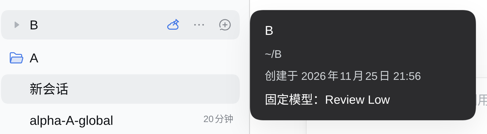
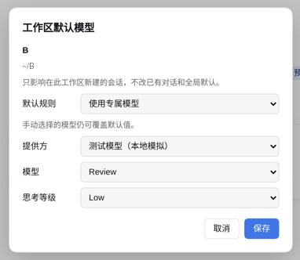

<h1 align="center">DSH Workspace Model</h1>

为 DeepSeek Harness 的每个工作区分别设置新会话的默认模型和思考等级。比如代码工作区用 Coding / High，审阅工作区用 Review / Low，其他工作区继续跟随全局。

**项目状态：** [安装包与发布说明](https://github.com/Sth32/dsh-workspace-model/releases/latest) · [兼容与验证](#兼容与验证) · [MIT](LICENSE)

## 安装

- **锁定版本：** 在 [Releases](https://github.com/Sth32/dsh-workspace-model/releases) 选版本，使用该版本的 `.tgz` 链接安装。
- **Web：** `dsh plugin --profile web add <.tgz 的 URL 或本地绝对路径>`。也可从 GitHub 安装：`dsh plugin --profile web add github:Sth32/dsh-workspace-model`；需要固定版本时优先使用发布包。
- **Desktop：** 在「插件 → 添加插件」填入版本包链接。安装或更新后完整重启 DSH，再在插件详情核对版本。

## 使用

1. 点工作区标题旁的云朵，或从工作区菜单进入「默认模型设置」。
2. 选「使用专属模型」，选择提供方、模型和思考等级，保存。云朵加图钉代表已启用；悬停工作区标题可看到固定模型。
3. 切回「跟随全局」即恢复全局默认值，原专属设置会保留，下次可以直接开启。

## 兼容与验证

- **安装范围：** DSH `>=0.2.2-rc.5 <0.3.0-0`。允许 0.2.x 后续预览版安装，不代表已验证。Node.js `>=24.9.0`。
- **实际验证：** DSH Web `0.2.2-rc.5` 和 `0.2.3-alpha.2` 的原生侧栏、亮暗模式、新会话请求和重启持久化。使用本地模拟提供方，不消耗模型额度。[验收详情](VALIDATION.md)。
- 配置按工作区保存。插件不改写全局默认值，不改已开始的对话，不读取 API Key，不向第三方发送数据。用户仍可在会话里手动选模型。若配置的模型失效，则保留 DSH 原有选择。

开发：Node.js 24 环境运行 `npm test`、`npm pack`。本项目由社区维护，与 DeepSeek 无隶属关系。
